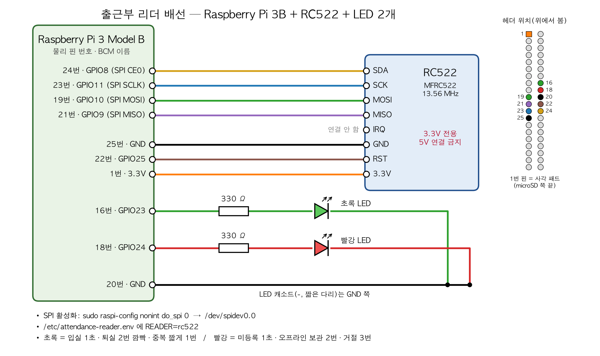

# 비공개 출근부 스냅샷·자동화 모니터

Pi의 Python 리더·LAN 서버가 학번을 Internal 회원과 대조하고 SQLite에 입퇴실을 저장합니다. Worker는 별도 KV 스냅샷을 제공하는 읽기 전용 원격 화면입니다. Worker VPC binding, Basic 비밀번호, UID 수동 등록은 사용하지 않습니다.


## 출입 원장과 회원 식별

- 출입 판정은 Pi의 SQLite에서만 수행합니다. 원격 KV의 지연된 읽기로 입퇴실을 판정하지 않습니다.
- 태그는 입실·퇴실을 번갈아 기록합니다. 중복·오래된 재전송은 새 출입으로 처리하지 않습니다. 최대 6시간을 넘긴 열린 세션은 다음 태그에서 미퇴실 세션으로 닫으며 유효 체류 시간에 합산하지 않습니다.
- 날짜·이번 주 경계는 KST입니다. 오늘·이번 주 요약은 양수인 유효 체류 시간이 있는 회원의 중앙값입니다.
- 학번 조회 404는 LAN의 익명 방문자 정책을 따릅니다. 원장에 학번이나 카드 UID를 저장하거나 UID를 학번으로 추측해 연결하지 않습니다.
- 현재 입실자는 이름·체류 시간만 4열×2행으로 표시하고 넘치는 인원은 페이지를 넘깁니다. 최근 기록·사이드바·수동 카드 등록 패널은 제공하지 않습니다.
- 자동 테마는 병천면의 일출·일몰을 브라우저에서 계산합니다. 외부 위치·폰트 서비스를 호출하지 않습니다.
- LAN은 저장 이벤트로 즉시 갱신하고 KOIN 모니터와 15초 간격으로 교대합니다. 유효 태그는 출근부로 복귀시키고 입실·퇴실 인사 모달을 표시합니다.
- 실물 학생증의 비금융 학번 읽기 규격이 없으면 지원으로 간주하지 않습니다. 보호 키·금융 앱을 탐색하거나 UID로 사람을 임의 등록하지 않습니다.

## 원격 조회·접근 정책

- 해당 Worker의 모든 URL을 Cloudflare Access로 보호하고 조직 Gateway를 필수로 요구합니다. 일반 소비자 WARP나 클라이언트가 보낸 인증 헤더는 허용 근거가 아닙니다.
- Worker는 플랫폼의 `ctx.access.aud`를 실제 `CF_ACCESS_AUD`와 비교합니다. 인증되지 않은 별도 호스트·서비스 호출은 데이터를 읽지 못합니다.
- 회원 자격은 실제 Internal 학번·비밀번호 로그인과 매 요청의 `/v1/members/attendance-session` 검증으로 확인합니다. 이메일 일치, 회원 조회 성공, 별도 Keycloak 계정만으로 로그인 자격을 추정하지 않습니다.
- Internal의 15분 access token은 `Secure; HttpOnly; SameSite=Strict`의 `__Host-attendance-session` 쿠키에만 보관하며 JSON·브라우저 저장소에 전달하지 않습니다. 계정 비활성화·탈퇴·비밀번호 변경·만료는 다음 검증에서 차단하고 화면의 비공개 상태를 지웁니다.
- Worker는 고정된 `https://bcsd-attendance-auth.koreatech.in`의 로그인·세션 두 경로만 호출합니다. 전용 Cloudflare 서비스 토큰과 터널의 Access JWT 검증을 사용하며 일반 Internal API·관리자 경로는 공개하지 않습니다.
- 원격 화면은 기본 180초 간격 스냅샷이며 KV의 지역별 반영 지연이 추가됩니다. 체류 시간·지표는 실제 관측 시각에 고정하고 스냅샷임을 표시합니다. LAN의 즉시 갱신과 다릅니다.
- 관측 후 5분 초과, 필수 데이터 누락·손상, 인증·연결 실패 시 과거 수치를 현재처럼 연장하지 않고 사용 불가로 처리합니다.
- `VIEW_STATE`의 `clubroom:view:v1`만 조회합니다. 기존 `ATTENDANCE` KV 데이터는 보존하며 자동으로 병합·이관·삭제하지 않습니다.
- 서버 응답·관측 시각, 검증된 Wi-Fi PNG, 설정된 실제 Jam PNG만 게시합니다. 카메라·토큰·원본 태그 큐·원장 파일은 게시하지 않습니다.

| Worker 경로                                                  | 용도                                      |
| ------------------------------------------------------------ | ----------------------------------------- |
| `GET /`, `HEAD /`                                            | 실제 LAN 템플릿 기반 원격 화면            |
| `POST /api/login`, `GET /api/me`, `POST /api/logout`         | Internal 로그인·세션 확인·자기 쿠키 종료  |
| `GET /api/view-status`, `/health`                            | 스냅샷 가용성·관측 시각                   |
| `GET /api/state`                                             | 출근부 조회                               |
| `GET /api/monitor`, `/api/koin-health`, `/api/worker-health` | 실제 서버·서비스 관측 응답                |
| `GET /api/spotify`, `/api/jam`                               | 관측 당시 재생 정보·실제 Jam 설정 여부    |
| `GET /api/wifi-qr/2.4`, `/api/wifi-qr/5`, `/api/jam-qr`      | 스냅샷에 존재하는 검증된 PNG              |
| `GET /api/automation`                                        | Pi 스냅샷과 독립적인 오류 수신·Rocky 상태 |

Worker의 태그·등록·관리자·카메라 쓰기 경로는 제공하지 않습니다. 로그인·로그아웃은 조회 세션만 변경하며 원격 화면에서 출입 원장을 변경할 수 없습니다.

## Worker 빌드·배포

```sh
pnpm --filter @koin/attendance build
pnpm --filter @koin/attendance typecheck
pnpm --filter @koin/attendance test
pnpm --filter @koin/attendance test:runtime
pnpm deploy:attendance
```

Worker 검사는 Node.js 24에서 실행합니다. `test:runtime`은 POSIX 파일 권한을 사용하는 Pi·LAN 코드 때문에 Linux와 Python 3.11 이상이 필요합니다. Windows에서는 Worker 검사와 게시기 검사를 실행하고 리더·LAN 검사는 격리된 Pi/Linux에서 실행합니다. 런타임 검사는 실제 GPIO·회원 API·운영 원장을 사용하지 않습니다.

빌드는 설치된 `tsx`로 LAN 렌더러를 실행해 `.wrangler/viewer/dashboard.html`을 생성합니다. Worker는 이 파일을 Text 모듈로 가져오며 별도 Static Assets 인증 우회 경로를 만들지 않습니다.

`wrangler.jsonc`에는 실제 별도 KV ID와 service binding을 설정합니다. 운영의 `CF_ACCESS_AUD`는 별도 환경 변수로 관리하고 `keep_vars: true`로 보존합니다. 조직 Gateway·회원 자격 정책이 적용되기 전에는 `workers_dev`를 활성화하지 않습니다. 미리보기 URL은 비활성 상태를 유지하며 원장 KV를 삭제하거나 덮어쓰지 않습니다.

`INTERNAL_AUTH_CLIENT_ID`, `INTERNAL_AUTH_CLIENT_SECRET`은 인증 중계 앱 한 곳만 허용하는 전용 서비스 토큰으로 설정합니다. 기존 기기·lookup·monitor·관리자 토큰이나 Internal의 JWT 서명 키를 재사용하지 않습니다. 자격증명·비밀번호·원본 인증 응답을 Git이나 로그에 기록하지 않습니다. 인증 중계가 없거나 검증에 실패하면 데이터를 제공하지 않습니다.

로컬 `wrangler dev`에서는 실제 플랫폼 인증이 없으면 실패합니다. 인증 개발 설정은 로컬 프로세스에만 적용하고 운영에서 클라이언트 헤더로 인증을 흉내 내지 않습니다.

## 오류 수신·Rocky 읽기 전용 모니터

- `ERROR_AUTOMATION` service binding으로 고정된 `bcsd-error-automation`의 `/healthz`와 `/healthz/rocky`를 병렬 조회합니다. Pi 스냅샷이 없어도 이 조회는 독립적으로 동작합니다.
- `ERROR_MONITOR_TOKEN`은 두 Worker만 공유하는 신규 전용 secret입니다. 브라우저·Pi에는 전달하지 않으며 기기·대시보드·실행기·진단·모델 토큰과 재사용하지 않습니다.
- 수신 요약은 Sentry/Cloudflare 최근 24시간의 고유 오류 등록 건수·최근 신규 등록 시각·최대 10개 처리 상태입니다. 건수는 목록 제한과 독립적으로 계산하며 중복 전달량이 아닙니다. PR 리뷰 작업과 미사용 `koin-api` 기록은 제외합니다.
- Rocky는 error-automation이 기존 `OMP_GATEWAY` VPC와 `koin-omp-gateway-rocky` 터널의 고정 healthz를 별도 `OMP_GATEWAY_MONITOR_TOKEN`으로 읽습니다. 이 호스트 토큰은 출근부가 받지 않습니다.
- CPU는 Linux `/proc/stat` 두 표본의 busy 비율, RAM은 `MemTotal − MemAvailable`입니다. 실행기·브로커의 서비스·프로세스 상태와 브로커 HTTP 응답·모델 정상 여부를 구분합니다. 모델 생성·작업 claim·GitHub 작업은 수행하지 않습니다.
- 최상위 `state`/`data`는 수신 요약이고 `rocky.state`/`rocky.data`는 호스트 관측입니다. 실패는 해당 결과의 unknown/null이며 실제 빈 저장소만 0건입니다. 측정 실패 CPU/RAM도 null입니다.
- 60초마다 조회하며 서버 조회별 5초·16 KiB·리다이렉트 거절·UTF-8·120초 신선도 검사를 적용합니다. `servedAt`과 단조 시계로 화면의 확인 기한을 계산하므로 키오스크 벽시계에 의존하지 않습니다.
- 연결 실패·오프라인·숨김·기한 초과는 미확인으로 표시하고 마지막 관측은 과거 기록으로 구분합니다. Pi 스냅샷 표시가 중단돼도 독립 모니터는 표시합니다.
- 오류 전문·프롬프트·소스·로그·원본 provider ID·lease·자격 증명은 반환하지 않습니다. 상세 호스트 설정은 [게이트웨이 운영 계약](../../scripts/autofix/README.md#rocky-읽기-전용-헬스-활성화)을 따릅니다.

## 스냅샷 게시기

`snapshot/publish.py`는 고정된 Pi5의 허용된 GET 경로만 수집합니다. 기본 실행은 I/O 없는 계획 출력입니다. 실제 account·namespace, 인증 출처, 영구 private checkpoint 디렉터리를 지정하고 `--once` 또는 `--loop`로 게시합니다.

- 게시 간격은 최소 180초, 일일 시도 예산은 600회입니다. 실패한 쓰기도 예산에 포함하며 공유 계정 한도 때문에 무과금을 보장하지 않습니다.
- 전용 기기 토큰의 KV Storage Write는 계정 범위입니다. 다른 KV에 대한 쓰기 위험을 검토한 뒤 사용합니다.
- 운영자 PC의 기존 Wrangler 세션은 명시적 `--operator-wrangler-auth-file`로만 사용합니다. 광범위한 OAuth 세션을 Pi로 복사하지 않습니다. 만료 시 인증된 `wrangler kv namespace list`로 정상 갱신하며 `whoami`만으로 갱신됐다고 간주하지 않습니다.
- 관리자 WARP 경로가 SSH만 허용하면 먼저 고정 호스트 키를 검증하는 `ssh -N -L 127.0.0.1:8080:127.0.0.1:8080 bcsd-pi`를 연결하고 게시기에 `--ssh-forward`를 지정합니다. 연결 대상만 localhost로 바꾸며 원래 Host와 허용 경로를 유지합니다.
- 게시기·인증·사설 조회 경로가 중단되면 원격 화면도 신선도 제한 후 사용할 수 없습니다. cloudflared 설치 자체는 게시기나 Internal 송신 인증을 대신하지 않습니다.

## LAN 서버

`lan/server.py`는 IPv4 `0.0.0.0:8080`에 바인딩하지만 읽기 출발지는 loopback·`192.168.1.0/24`로 제한합니다. 이 LAN 읽기에는 로그인이 없고 실제 이름·Wi-Fi 비밀번호를 볼 수 있습니다. 인터넷에 직접 게시하지 않습니다.

태그 POST는 loopback 출발지, 올바른 Host·Origin, 별도 `DEVICE_TOKEN`을 모두 요구합니다. 서비스는 root 소유 `0600` 파일의 토큰을 systemd credential로 전달받습니다. `/etc/attendance-lan/config`의 `INTERNAL_LOOKUP_URL`은 고정된 HTTPS `api.internal.bcsdlab.com/v1/service/attendance/member-lookup`이며, lookup·device·monitor 자격증명은 목적별로 분리합니다. HTTPS 전달은 실제 Internal 호스트의 SNI·인증서를 검증하고 TLS 검증을 끄지 않습니다.

`lan/attendance-lan.service`와 `pi/attendance-reader.service`를 활성화하면 부팅 시 실행됩니다. 실제 사설 회원 조회 경로·토큰을 준비한 뒤 시작합니다. SQLite와 원본 큐는 private 디렉터리·파일 권한을 유지합니다.

Wi-Fi QR은 실제 비밀번호로 생성한 작은 PNG를 로컬에 설치하고 `WIFI_QR_24_FILE`, `WIFI_QR_5_FILE`로 지정합니다. 화면을 볼 수 있는 사람은 QR에서 비밀번호를 알 수 있으므로 표시 범위를 제한합니다. Jam은 실제 휴대폰 초대 링크로 만든 root 소유 PNG를 `JAM_QR_FILE`로 지정하며 미설정이면 숨깁니다. 곡·기기 URL로 Jam 초대를 만들어 대체하지 않습니다.

## 라즈베리파이 리더

리더는 Android 학생증 HCE에서 읽은 학번·태그 시각을 loopback LAN 서버에만 전송합니다. 서버가 조회한 회원 정보로 입퇴실을 처리하며, 클라우드 UID API·HID 수동 등록은 사용하지 않습니다. 칩 초기화·RF 복구 후에는 카드가 제거된 간격을 확인한 뒤 새 태그를 받으므로 계속 올려 둔 카드를 재시작만으로 새 출입으로 처리하지 않습니다.

### RC522 배선



| 부품         | 연결                                | Pi 물리 핀(BCM) |
| ------------ | ----------------------------------- | --------------- |
| RC522 SDA    | SPI CE0                             | 24 (GPIO8)      |
| RC522 SCK    | SPI SCLK                            | 23 (GPIO11)     |
| RC522 MOSI   | SPI MOSI                            | 19 (GPIO10)     |
| RC522 MISO   | SPI MISO                            | 21 (GPIO9)      |
| RC522 IRQ    | 연결 안 함                          | -               |
| RC522 GND    | GND                                 | 25              |
| RC522 RST    | 리셋                                | 22 (GPIO25)     |
| RC522 3.3V   | 3.3V 전원(5V 연결 금지)             | 1               |
| 초록 LED     | GPIO → 330 Ω → 애노드, 캐소드 → GND | 16 (GPIO23)     |
| 빨강 LED     | GPIO → 330 Ω → 애노드, 캐소드 → GND | 18 (GPIO24)     |
| LED 공통 GND | GND                                 | 20              |

### 설치

`reader.py`와 `hce.py`를 함께 `/opt/attendance`에 설치하고 SPI·GPIO 의존성을 준비합니다. APT를 사용할 때는 먼저 해당 Raspberry Pi OS에 맞는 한국 미러를 설정합니다. `/dev/spidev0.0` 존재만으로 카드 통신을 보장하지 않습니다.

리더 환경 파일은 root 소유 `0600`으로 관리하고 `ATTENDANCE_URL=http://127.0.0.1:8080`, LAN 서버와 일치하는 `DEVICE_TOKEN`을 지정합니다. 원본 큐 기본 경로는 `/var/lib/attendance/queue.jsonl`이며 `QUEUE_FILE`로 private 경로를 지정할 수 있습니다. 학번·토큰·큐 원문을 Git·로그·공유 문서에 넣지 않습니다.

서비스는 제한된 private 상태 디렉터리를 사용합니다. 전송 실패는 원래 태그 시각으로 순서대로 재전송하므로 NTP 동기화가 필요합니다. 인증·연결 실패를 성공이나 임의 회원 등록으로 바꾸지 않습니다.
