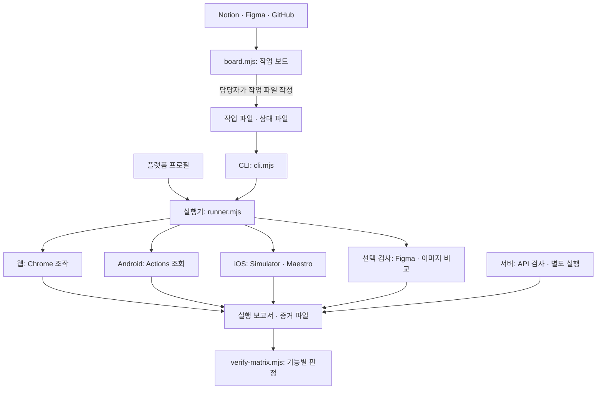

# 제품 개발 운영

KOIN 웹·Android·iOS의 기능 개발, 화면 개편, 오류 수정 절차다.

## 원칙

- 승인된 토큰·컴포넌트·패턴으로 만들 수 있으면 디자인을 기다리지 않고 구현한다. 기존 구현 전체를 표준으로 삼지는 않는다.
- UI를 바꾸는 신기능·화면 개편은 리뷰 전까지 Figma 프레임 URL·버전, 코드 커밋, 빌드 정보, 실행 결과를 남긴다. 원래 화면을 복구하는 오류 수정은 새 Figma가 필요 없다.
- 대상 플랫폼의 실제 앱을 지정 커밋에서 검증한다. 실행하지 못한 항목은 미검증으로 남긴다.
- 반복되는 리뷰 지적은 근거와 함께 규칙·린트·예시로 옮긴다. 새 표준은 사람이 승인한다.
- 목업은 API 연동 완료가 아니다. 프리뷰 승인은 출시 승인이 아니다.

## 작업 경로

| 종류                   | 필요한 자료                                    | 완료 조건                            |
| ---------------------- | ---------------------------------------------- | ------------------------------------ |
| 신기능 (`feature`)     | 기능·API 요구, 검사 순서, Figma, 플랫폼별 PR   | 새 동작을 실제 앱에서 끝낼 수 있다   |
| 화면 개편 (`redesign`) | 기준 디자인, 보존할 동작, Figma, 전후 캡처     | 기준에 맞고 기존 동작이 유지된다     |
| 오류 수정 (`error`)    | 오류 정보, 기준 커밋의 실패, 수정 후 실행 결과 | 실패가 해소되고 기존 동작이 유지된다 |

- 영향받는 플랫폼만 지정한다. 웹 PR 완료를 Android·iOS 완료로 세지 않는다.
- 화면 개편의 기준은 승인된 패턴·결정 기록·Figma다. 플랫폼 간 픽셀 일치는 요구하지 않는다.
- 오류 수정 결과가 기존 화면이나 기준과 달라지면 화면 개편 작업으로 분리한다.
- 같은 화면을 여러 작업이 바꾸면 기준 Figma·커밋과 통합 순서를 적는다. 한 작업의 승인을 다른 변경에 적용하지 않는다.

## 역할

| 담당                  | 업무·결정                                                                 |
| --------------------- | ------------------------------------------------------------------------- |
| PM                    | 기능 범위, 완료 조건, 미정 사항, 사용자 흐름·정보 구조, DA 확인 필요 여부 |
| DA                    | PM이 지정한 작업의 데이터·측정 방법, 지표의 시작·종료·집계 기준           |
| PE (디자인·웹·백엔드) | 작업 파일, Figma, 웹·서버 구현, API·권한·데이터 계약, 실행 결과           |
| Android·iOS 담당      | 해당 플랫폼 구현·Figma·실행 결과                                          |

- Figma는 화면을 구현한 사람이 직접 만든다. 프레임을 수정하면 버전 기록에 이름을 붙여 저장한다.
- 플랫폼별 리뷰어를 지정한다. 에이전트의 완료 보고나 캡처는 사람의 리뷰를 대신하지 않는다.

### 어떤 변경이 결정을 기다리는가

| 변경                                      | 처리                                            | 결정자               |
| ----------------------------------------- | ----------------------------------------------- | -------------------- |
| 승인된 컴포넌트·토큰·패턴 조합, 문구·배치 | 바로 구현한다. PM의 시각 승인을 기다리지 않는다 | 구현자·플랫폼 리뷰어 |
| 한 화면 전용 값·컴포넌트                  | 화면 안에 두고 이유를 PR에 적는다               | 플랫폼 리뷰어        |
| 여러 화면의 공통 컴포넌트·토큰·패턴       | 결정 기록과 디자인 시스템 변경 PR을 낸다        | 플랫폼 리뷰어        |
| 새 사용자 흐름·정보 구조                  | 결정 기록을 만든다                              | PM                   |
| API·권한·데이터 계약                      | 계약을 확정하고 서버 작업을 연결한다            | PE                   |

결정 대기 항목에는 담당자와 막힌 범위를 적는다. 나머지 구현은 계속한다. 검색 → 결과 → 빈 결과 → 실패처럼 사용자 행동별로 Figma·API·PR·검사를 묶되, 필수 범위를 생략하지 않는다.

## 디자인 시스템

승인된 토큰·컴포넌트·패턴을 사용한다. 값은 코드에서 정하고 Figma에 맞춘다.

### 범위

아래 공용 코드는 승인 여부가 정해지기 전까지 임시 기준으로 쓴다. 로그인 유도·사용자 정보 모달처럼 기능 전용인 코드는 다른 화면의 표준으로 삼지 않는다.

| 대상    | 위치                                  | 내용                                                                  |
| ------- | ------------------------------------- | --------------------------------------------------------------------- |
| 웹      | `apps/web/src/components/ui`          | Button, Badge, Selector, SearchBar, PageHeader 등                     |
| 웹      | `apps/web/src/utils/scss`             | `tokens.scss` 토큰, 기존 `order-palette`, `media`의 576px 모바일 분기 |
| Android | `KOIN_ANDROID`의 `core/designsystem`  | 디자인 시스템 모듈. 별도 저장소와의 관계는 미정                       |
| iOS     | `KOIN_iOS`의 `Koin/Core/DesignSystem` | ColorSystem, Typography, RadioButton, Toast                           |
| 문구    | `KOIN_STRINGS`                        | 공용 문구·용어집·생성기. 웹은 참조하지 않음                           |

### 규칙

- 웹은 `@use "src/utils/scss/tokens" as tokens;`로 토큰을 읽는다. 토큰 → 공용 컴포넌트 → 패턴 순서로 조합한다.
- `components/ui`의 직접 입력한 hex 색은 Stylelint가 거부한다. 필요한 값이 없으면 같은 변경에서 토큰에 추가한다.
- 토큰 치환은 값이 정확히 같을 때만 한다. 비슷한 색·크기로 합치는 것은 별도 디자인 변경이다.
- `pnpm development:tokens report apps/web/src`로 사용률을 확인하고 `apply <디렉터리>`로 치환한다.
- 공용 컴포넌트의 색·모서리·그림자를 화면에서 덮어쓰지 않는다. `className`은 배치에만 쓴다.
- 로딩·빈 상태·오류·권한 없음·비활성·긴 문구 등 도달 가능한 상태를 구현한다.
- 공통 컴포넌트·토큰·패턴은 두 화면 이상에서 필요할 때 추가한다. 같은 PR에 Figma와 결정 기록을 남긴다.
- 자동 판정은 린트로, 맥락이 필요한 판단은 에이전트 지침으로, 새 표준은 사람의 결정으로 둔다.

### 결정 기록

작성자가 `docs/product-development/decisions/`에 결정별 파일을 만든다. 위 표의 결정자가 승인한다. 취향 대신 동작·값·조건과 근거를 적는다.

```markdown
# Decision: {이름}

Status: proposed | accepted | rejected
Scope:
Decision:
Rationale:
Evidence: {PR·리뷰·Figma·Slack 링크}
Exceptions:
Bad example:
Good example:
Open decisions:
```

### 피드백 반영

반복 지적을 받은 사람이 근거 링크와 함께 `proposed` 기록을 낸다. 결정자는 규칙·린트·예시·변경 없음 중 하나를 고른다. 한 화면이나 리뷰 한 번만으로 공통 규칙을 만들지 않는다.

## 흐름

1. **접수:** PM이 기능·플랫폼·완료 조건을 정한다. PE가 API·권한·데이터 의존성을 확인하고 기준 커밋·리뷰어와 함께 작업 파일에 적는다.
2. **변경 전 확인:** 실제 앱을 실행하고 화면을 남긴다. 오류 수정은 실패 재현이 필수다. 환경 문제와 제품 오류를 구분한다.
3. **구현:** 기존 코드를 고친다. Figma 없이 먼저 실행할 수 있지만 신기능·화면 개편은 구현 기록과 리뷰 요청 전에 Figma를 남긴다.
4. **검증:** 검사 결과·캡처·영상·미확인 항목을 모은다. 웹은 커밋, Android는 실행 ID, iOS는 커밋·Simulator로 빌드를 식별한다.
5. **리뷰:** PM은 동작을, 플랫폼 리뷰어는 코드·화면·기존 동작 보존을 확인한다. 새 커밋이나 Figma 버전에서는 이전 검증·승인을 다시 받는다. 이전 지적도 해결 여부를 확인한다.
6. **출시:** 플랫폼별 상태를 나누고 각 저장소의 심사·배포 절차를 따른다.

막힌 의존성은 실제 연동 근거가 있을 때만 해소로 바꾼다.

## 하니스

`scripts/development`의 CLI로 작업·실행·검증 상태를 관리한다. PE나 플랫폼 담당이 자신의 장비에서 실행한다.

### 구조



### 실행 절차

작업·상태·프로필·출력은 저장소 밖의 `$WORK`에 둔다. `scripts/development/examples/dining.task.example.json`과 `scripts/development/profiles/*.example.json`을 복사해 경로·커밋·리뷰어를 채운다. 대상 코드는 별도 작업 디렉터리에 지정 커밋으로 체크아웃한다. 아래 명령은 하니스 저장소 루트에서 실행한다.

```sh
WORK=/절대/경로/작업-디렉터리
pnpm development brief "$WORK/task.json"
pnpm development run "$WORK/task.json" web "$WORK/web.profile.json" <기준 커밋> "$WORK/out/baseline"
pnpm development init "$WORK/task.json" "$WORK/state.json"
pnpm development next "$WORK/task.json" "$WORK/state.json"
pnpm development implement "$WORK/task.json" "$WORK/state.json" web <구현 커밋> <PR URL> <Figma URL> <Figma 버전>
pnpm development verify "$WORK/task.json" "$WORK/state.json" web "$WORK/web.profile.json" "$WORK/out/verify"
pnpm development review "$WORK/task.json" "$WORK/state.json" web <구현 커밋> <리뷰어> <리뷰 근거>
pnpm development release "$WORK/task.json" "$WORK/state.json" web <구현 커밋> <출시 근거>
pnpm development report "$WORK/task.json" "$WORK/state.json"
```

출력 디렉터리는 매번 새로 지정한다. 보고서는 `report.json`, 증거 파일은 `artifacts/`에 남는다.
검증 실패 2회 뒤에는 지정 리뷰어가 `pnpm development handback "$WORK/task.json" "$WORK/state.json" web <리뷰어> <확인 사유>`로 재개한다. 나머지 명령은 `pnpm development --help`에서 확인한다.

### 계약

- 작업 파일에는 `feature`·`redesign`·`error` 중 종류, 목표, 검사 순서, 플랫폼별 저장소·기준 커밋·리뷰어, 의존성을 적는다. 실행 대상은 웹 `BCSD_united`, Android `KOIN_ANDROID`, iOS `KOIN_iOS`다.
- 구현 커밋이나 Figma 버전이 바뀌면 `implement`를 다시 기록한다. 검증·리뷰·출시는 초기화된다.
- 작업 파일이 바뀌면 새 상태 파일을 만든다. 이전 기록은 보존하되 승인을 복사하거나 상태를 손으로 고치지 않는다.
- 성공한 빌드 단계와 모든 검사 순서의 실행 근거가 있어야 통과한다. 막힌 의존성이 있으면 통과하지 않는다.
- 오류 수정은 별도의 기준 커밋 체크아웃에서 실패를 재현해야 한다. 모바일 재현 프로필이 없으면 미검증이다.
- 실행 전후 HEAD가 지정 커밋과 같고 체크아웃이 깨끗해야 한다. 증거 파일은 SHA-256과 함께 복사한다.
- `paths`는 허용할 저장소 경로 목록이다. 기준·구현 커밋 사이의 변경이 범위를 벗어나면 실행 전에 차단한다.
- 플랫폼별 검증 실패는 2회까지다. 새 커밋으로 횟수를 초기화할 수 없다. 이후에는 지정 리뷰어의 `handback`이 필요하다. 실행 전 차단은 횟수에 넣지 않는다.
- 실패 로그 끝 20줄 이내를 보고서에 남긴다. 증거 파일이 없어도 앞선 빌드·검사 실패를 유지한다.
- 프로필은 실행자가 관리한다. webhook·요청 입력으로 받지 않고 실제 운영 프로필은 커밋하지 않는다.
- 비밀 파일은 필요한 빌드 경로에만 둔다. 실행자가 프로필·증거 목록·로그에 비밀 값이 없는지 확인한다.

### 기능·플랫폼 통합 판정

`verify-matrix.mjs`로 기능별 검증 목표와 실행 보고서를 연결한다.

```sh
pnpm development:matrix "$WORK/matrix.json" "$WORK/coverage.json" "$WORK/coverage.md"
```

- 검사는 화면 진입(`render`), 흐름(`flow`), API 기동(`api-smoke`), 계약(`contract`), 사용자 동작(`journey`), 인증(`auth`), 빈 상태·오류(`empty-error`), 접힘(`posture`), 상태 보존(`continuity`)으로 구분한다.
- 입력은 `schemaVersion: 1`, `sources`, `checks`다.
  - 출처: `id`, `path`(입력 파일 기준), `platform`, 전체 `sha`, `kind`.
  - `kind`: `web-screen`, `maestro-flow`, `ios-flow`, `api-smoke`, `contract-test`, `journey`.
  - 목표: 고유 `id`, `feature`, `platform`, `level`, `source`(출처 ID 또는 `null`), `scenarios`(필요한 시나리오 ID).
- 출처가 없으면 미검증이다. 보고서의 플랫폼·커밋·빌드·시나리오 실행을 확인한다. 잘못된 이전 통과는 출처의 `invalidated`로 철회한다.
- `journey`·`contract-test` 보고서는 시나리오별 `levels` 배열에 실제 검사 수준을 명시해야 한다. 화면 검사나 출처 이름 변경만으로 사용자 동작·인증·접힘 통과를 만들 수 없다.
- 전체 통과는 exit 0, 실패·차단·미검증은 exit 1, 입력 오류는 exit 2다. 이 도구는 보고서를 평가하며 앱을 실행하지는 않는다.

### 작업 보드

`board.mjs`는 `examples/board.features.example.json`의 기능 목록으로 Notion·Figma·GitHub 상태와 빠진 연결을 모은다. 원본 상태는 바꾸지 않는다.

```sh
pnpm development:board collect "$WORK/features.json" "$WORK/sources.json"
pnpm development:board render "$WORK/sources.json" "$WORK/board.md"
```

| 출처   | 수집 항목                                  | 인증           |
| ------ | ------------------------------------------ | -------------- |
| GitHub | 제목에 키워드가 있는 플랫폼별 이슈·PR 상태 | `gh` 로그인    |
| Notion | 연결한 기획·명세·QA·로깅 표                | `NOTION_TOKEN` |
| Figma  | 연결한 프레임의 파일 버전·수정 시각        | `FIGMA_TOKEN`  |

토큰이 없으면 “수집 안 됨”으로 표시한다. 조회 결과가 빈 것과 구분한다. 기획·QA·Figma 미연결, 플랫폼별 이슈·PR 없음, 열린 이슈의 PR 없음, 미완료 QA를 표시한다. Notion 통합은 소유자가 만들고 페이지에 연결한다.

### 디자인 QA

[KOIN_DESIGN_QA_AGENT](https://github.com/BCSDLab/KOIN_DESIGN_QA_AGENT)의 `koin-qa`로 실행 화면과 Figma를 비교한다. `design-qa.mjs`는 프로필 단계로 실행해 `report.json`·`report.md`를 남긴다.

웹은 지정 커밋의 캡처를 `koin-qa compare`에 전달한다. 설정 예시는 `profiles/web.example.json`, `examples/design-qa.web.example.yaml`이다. `FIGMA_TOKEN`·`OPENAI_API_KEY`는 실행 환경에서만 제공한다.

### 플랫폼 실행

| 플랫폼  | 도구·동작                                                        | 조건                          |
| ------- | ---------------------------------------------------------------- | ----------------------------- |
| 웹      | `web-scenario.mjs`: 개발 서버·Chrome 조작                        | Node·Chrome                   |
| Android | `github-run.mjs`: 지정 커밋의 Actions 작업·산출물 조회           | 대응하는 Maestro 실행         |
| iOS     | `ios-scenario.mjs`, `flows/ios-*.yaml`: Simulator 빌드·실행·녹화 | macOS·Xcode·Maestro·빌드 설정 |

Android:

- 대응 실행이 없으면 구현자가 리뷰어에게 수동 실행을 요청한다. 하니스는 Slack 알림이 발생하는 워크플로 실행을 대신 요청하지 않는다.
- 기존 Maestro 워크플로는 `production` PR 생성, 주간 일정, 수동 요청으로 실행된다.
- YAML·작업이 있는 검사만 판정한다. 로그인 검사가 실패하면 로그인 후 기능은 미검증이다.
- 전체 실행 결과가 아니라 대상 작업과 산출물로 판정한다. 다른 작업의 실패도 기록한다.

iOS:

- `koinUnitTests`를 화면 조작 검증으로 세지 않는다. 현재 Maestro 흐름은 이 저장소에 있으며 화면 문구에 의존한다.
- `node scripts/development/ios-devices.mjs`로 설치된 Simulator의 이름·UDID·런타임을 조회한다.
- 별도 설치 없이 `node scripts/development/connect-api.mjs`로 SSH 별칭 `rocky-desktop`·`butler`를 연결한다. Mac의 API 주소는 `http://localhost:18480`이다. 터미널 종료 시 해제되는 임시 검증용 연결이며 `--check`는 응답 확인 후 닫는다.
- `ios-scenario.mjs --device <UDID 또는 정확한 이름>`은 빌드·설치·Maestro·녹화에 같은 기기를 쓴다. 중복 이름·미설치 기기는 대체하지 않고 거부한다. `--display`는 녹화 화면이며 기본값은 `primary`다.
- iPhone Duo는 지원 Xcode·런타임이 필요하다. [Apple 기준](https://developer.apple.com/documentation/technologyoverviews/preparing-your-app-for-iphone-duo)에 따라 외부·내부 화면, 부분 접힘·펼침, 회전, 바·시트·팝오버·접힘 영역을 확인한다. 일반 iPhone이나 창 크기 변경으로 대체하지 않는다.
- 식단 진입도 A/B 배정·로깅을 호출한다. 날짜·데이터·계정·A/B 상태를 고정한다.

### 기준 시나리오

식단은 상태 전환 검사의 예시다. 전체 기능 검증을 대신하지 않는다.

| 검사      | 웹                 | Android                              | iOS                                 |
| --------- | ------------------ | ------------------------------------ | ----------------------------------- |
| 식단 진입 | `web-scenario.mjs` | `.maestro/dining.yaml`               | `flows/ios-dining-view.yaml`        |
| 끼니 변경 | `web-scenario.mjs` | 점심 선택 후 결과 검증이 없어 미검증 | `flows/ios-dining-meal-change.yaml` |
| 날짜 변경 | `web-scenario.mjs` | 없음                                 | 없음                                |

예시 작업은 웹의 세 검사를 담는다. 모바일은 실제로 실행·확인한 범위만 완료로 표시한다.

### 웹 전체 화면

`scripts/development/screens/web.json`의 공개 화면을 데스크톱·모바일에서 검사한다. 로그인 화면은 비로그인 이동만 확인하고 기능은 미검증으로 남긴다. 비활성 주문 화면은 사유를 적고 건너뛴다. API·루트 셸은 화면 목록에서 제외한다.

```sh
pnpm development:web --sha <전체 SHA> --checkout <웹 체크아웃 절대 경로> --reviewer <리뷰어> --work "$WORK"
pnpm development run "$WORK/web.task.json" web "$WORK/web.profile.json" <전체 SHA> "$WORK/out"
```

개발 서버 하나로 화면을 순회하며 문서 오류·오류 경계·예외·`console.error`·동일 출처 API의 5xx를 검사하고 캡처한다. 예상한 404는 목록에 명시한다. 상세 ID·데이터가 바뀌면 근거와 값을 갱신한다. 화면 진입만으로 검색·작성·결제 완료를 판정하지 않는다.

### Android 전체 흐름

`android-suite.mjs`는 지정 실행의 모든 `Maestro <flow>` 작업을 프로필로 만든다. 실패한 작업도 포함한다.

```sh
pnpm development:android --run-id <실행 ID> --sha <전체 SHA> --checkout <Android 체크아웃 절대 경로> --reviewer <리뷰어> --work "$WORK"
pnpm development run "$WORK/android.task.json" android "$WORK/android.profile.json" <전체 SHA> "$WORK/out"
```

기존 실행을 조회하며 앱을 다시 실행하지 않는다. 작업 성공은 YAML의 검사 범위만 증명한다.

### 회귀 실행 준비

`visual-diff.mjs`로 기준 캡처와 현재 캡처를 비교한다. 커밋·기기·화면 크기·언어·데이터·시각을 고정하고 기준 파일은 체크아웃 밖에 둔다. 기준 갱신은 사람이 승인한다.

```sh
pnpm development:visual --baseline "$WORK/baseline" --actual apps/web/.wrangler/harness/screens --out apps/web/.wrangler/harness/diff
```

프로필 단계에 명령을 넣고 결과의 `result.json`을 증거 목록에 추가한다. 누락·추가·크기 변경은 실패다. 8비트 RGB/RGBA 비인터레이스 PNG만 지원한다. `--threshold`는 채널 차이, `--max-ratio`는 다른 픽셀 비율의 허용치다. 기능·Figma 검사는 별도로 한다.

| 장비       | 준비 항목                                                                                                           |
| ---------- | ------------------------------------------------------------------------------------------------------------------- |
| Mac Studio | Xcode·Maestro·iOS 체크아웃·`Debug.xcconfig`·`GoogleService-Info-Stage.plist`·`profiles/ios.mac-studio.example.json` |
| 5500GT     | 웹 회귀 실행 시 Node·pnpm·Chrome·웹 체크아웃·`profiles/web.example.json`                                            |

## 자동화 경계

- [오류 자동 수정](../../apps/error-automation/README.md)과 [실행기](../../scripts/autofix/README.md)는 `BCSD_united`의 Sentry·Cloudflare → web/api만 대상으로 한다. 삐봇의 `수정요청`도 같은 큐를 쓴다. 확장은 [별도 계약](../../scripts/autofix/EXTENDING.md)을 따른다.
- Android Crashlytics는 `KOIN_CRASHLYTICS_AUTOFIX`가 `production`·`develop`에 PR을 만든다.
- 자동화 PR은 각자의 리뷰·병합 정책을 따른다. 하니스의 오류 작업은 사람이 작업 파일로 접수한 건이다.
- 하니스는 webhook·허용 저장소·배포 권한을 넓히지 않는다. 운영·스토어 서명 자격은 코드 생성 에이전트에 주지 않는다.

## 지표

DA가 시작·종료 시점과 집계 방법을 정한다.

- 요청부터 리뷰 가능한 실행 화면까지의 시간
- 디자인 결정 대기 시간
- 사람의 리뷰 시간
- 재작업·회귀·반복 지적 횟수

개인을 봇의 PR 수로 평가하지 않는다.

## 아직 없는 것

결정 필요:

- Figma 파일·페이지·편집 권한과 모바일 담당의 프레임 제작 책임
- 디자인 시스템 CODEOWNERS. 지정 전에는 플랫폼 리뷰어가 결정
- Android 디자인 시스템 기준 위치와 iOS Maestro 흐름 유지 담당
- 반복 지적 검토 주기·주관자, `KOIN_STRINGS` 반영 여부·결정자
- 지표 집계 방법과 5500GT의 웹 회귀 대상

미구현·미검증:

- 공용 컴포넌트 카탈로그·상태별 승인 기준 이미지
- `components/ui` 밖의 토큰 전환·디자인 규칙 린트
- 코드 토큰의 Figma 내보내기·자동 프레임 생성
- 화면 요소·버전별 댓글 연결
- 실제 iOS 앱 검증과 접근성 식별자 보강
- Android·iOS 날짜 변경, Android 끼니 전환 결과 검사
- iOS 식단 외 사용 순서 검사와 Android 공통 홈 진입 실패 해결
- 모바일 기준 커밋의 실패 재현 프로필
- 웹의 `KOIN_STRINGS` 연결

## 참고한 운영 방식

| 출처                                                                                                     | 적용                                                 |
| -------------------------------------------------------------------------------------------------------- | ---------------------------------------------------- |
| [Vercel](https://vercel.com/blog/teaching-agents-product-design-at-vercel)                               | 코드 옆에 디자인 결정·근거·빠진 기준 보관            |
| [Stripe Harbor](https://stripe.dev/blog/harbor-stripes-ai-assisted-prototyping-tool)                     | 실행 화면 리뷰와 버전별 피드백                       |
| [Microsoft](https://commandline.microsoft.com/mini-foundry-design-journey-evaluation/)                   | 화면 진입과 전체 사용 순서 검증 구분                 |
| [Linear](https://linear.app/now/behind-the-latest-design-refresh)                                        | 코드의 토큰 값을 Figma에 반영                        |
| [Stripe Minions](https://stripe.dev/blog/minions-stripes-one-shot-end-to-end-coding-agents-part-2)       | 실패 2회 후 사람에게 인계, 정해진 절차는 코드로 실행 |
| [Spotify Honk](https://engineering.atspotify.com/2025/12/feedback-loops-background-coding-agents-part-3) | 변경 범위 검사와 실패 로그 요약                      |
| [Anthropic](https://www.anthropic.com/engineering/effective-harnesses-for-long-running-agents)           | 시작 시 진행 상태 확인, 완료 조건 고정               |
| [OpenAI](https://openai.com/index/harness-engineering)                                                   | 문서 지도와 경로 검사                                |
| [Martin Fowler](https://martinfowler.com/articles/harness-engineering.html)                              | 실행 전 안내와 실행 후 검사 구분                     |
