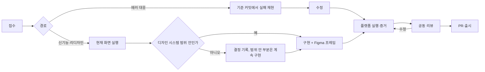

# 제품 개발 운영

KOIN 웹·Android·iOS의 신기능, 통일성 리디자인, 에러 대응을 PM·DA·PE가 하나의 작업 단위로 진행하는 방법이다. 디자인 시스템 범위 안의 화면은 제작을 기다리지 않고 구현하며, UI를 바꾸는 작업은 Figma와 실행 결과를 함께 남긴다.

## 원칙

1. **디자인 시스템이 기본값이다.** 수락된 토큰·컴포넌트·패턴으로 만들 수 있는 화면은 선행 디자인 없이 구현하고, 실행 화면으로 리뷰한다. 기존 구현 전체를 표준으로 보지 않는다.
2. **산출물은 Figma + α다.** UI를 바꾸는 신기능·리디자인은 해당 Figma 프레임·버전, 소스 커밋, 빌드 식별자, 실행 증거(캡처·영상·검사 결과)를 같은 작업에 남긴다. Figma 프레임은 구현 착수의 선행 조건이 아니며 리뷰를 요청하기 전까지 만든다. 원래 화면으로 복구하는 에러 수정은 Figma 프레임 없이 실행 증거만 남긴다.
3. **실제 앱에서 확인한다.** 작업 대상 플랫폼을 고정 커밋에서 실행한다. 실행하지 못한 플랫폼과 시나리오는 미검증으로 남긴다.
4. **반복되는 판단은 저장소에 둔다.** 같은 리뷰 지적이 반복되면 규칙·린트·예시로 옮기고, 새 표준은 사람이 승인한다.
5. **목업과 출시를 구분한다.** 목업 데이터로 동작한 화면을 API 연동 완료로 세지 않는다. 프리뷰 승인은 출시 승인이 아니다.

## 작업 경로

공통 기반(접수, 고정 커밋, 플랫폼 실행, 증거 수집, 리뷰·출시 상태) 위에 완료 기준이 다른 세 경로를 둔다. 모든 작업에 에러 재현을 요구하거나 모든 작업에 새 화면 제작을 요구하지 않는다.

| 경로                   | 출발점                          | 반드시 남길 것                                 | 완료 기준                                    |
| ---------------------- | ------------------------------- | ---------------------------------------------- | -------------------------------------------- |
| 신기능 (다국어·복덕방) | 기능 요청, API 요구             | 인수 시나리오, Figma 프레임·버전, 플랫폼별 PR  | 합의한 새 동작을 실제 앱에서 끝낼 수 있다    |
| 통일성 리디자인        | 대상 화면군, 수락된 디자인 기준 | 보존할 기존 동작, Figma 프레임·버전, 전후 캡처 | 대상 화면이 기준에 맞고 기존 동작이 유지된다 |
| 에러 대응              | 오류·재현 증거                  | 기준 커밋의 실패 재현, 수정 후 복구 확인       | 관측된 실패가 해소되고 기존 동작이 유지된다  |

- 리디자인의 기준은 디자인 시스템 패턴, 수락된 결정 기록, Figma 중 하나다. 플랫폼 관례가 다르므로 픽셀 일치를 요구하지 않는다.
- 에러 대응은 원래 동작을 복구하는 한 새 디자인을 요구하지 않는다. 복구 결과가 기존 화면이나 수락된 기준과 달라지면 리디자인 작업으로 연결한다.
- 작업은 영향받는 플랫폼만 대상으로 지정한다. 웹 PR이 끝났다고 Android·iOS를 완료로 표시하지 않는다.
- 같은 화면을 여러 경로가 건드리면 기준 Figma 버전·코드 커밋·먼저 통합할 변경을 작업에 적는다. 한 작업의 승인이 다른 작업의 변경을 승인하지 않는다.

## 역할

역할은 PM, DA, PE, Android·iOS 담당이다. 화면 제작·웹 구현·서버 변경은 서로 기다리지 않도록 PE 한 역할이 맡는다.

| 역할                  | 남기는 것                                                                            | 결정하는 것                                             |
| --------------------- | ------------------------------------------------------------------------------------ | ------------------------------------------------------- |
| PM                    | 기능 범위, 인수 시나리오, 미정 사항의 결정, DA 확인 필요 여부                        | 요구한 동작이 충족됐는지, 새 사용자 흐름·정보 구조      |
| DA                    | PM이 표시한 작업의 데이터 확인·평가 방법, 지표의 시작·종료 사건과 집계 방법          | 데이터 정의와 측정 방법                                 |
| PE (디자인·웹·백엔드) | 작업 파일, 편집 가능한 Figma 프레임(화면·상태), 웹 구현 PR, API·서버 변경, 실행 증거 | 디자인 시스템 범위 안의 화면 구성, API·권한·데이터 계약 |
| Android·iOS 담당      | 해당 플랫폼 구현 PR, 해당 플랫폼 화면의 Figma 프레임, 실행 증거                      | 플랫폼별 구현 방식                                      |

- Figma 프레임은 그 화면을 구현한 사람이 Figma 앱에서 직접 만든다. Figma를 자동으로 만드는 연결은 없다.
- Figma 버전은 프레임을 고친 뒤 Figma 버전 기록에 이름을 붙여 저장한 그 이름이다. 프레임을 고치면 새 버전을 기록하고 다시 검증한다.
- 한 사람이 세 스택을 모두 검토한다고 가정하지 않는다. 작업마다 플랫폼별 리뷰어를 지정한다.
- 에이전트는 초안 구현, 반복 수정, 빠진 상태 찾기, 증거 수집을 맡는다. 에이전트의 완료 보고나 캡처 한 장은 사람의 확인을 대신하지 않는다.

### 어떤 변경이 결정을 기다리는가

| 변경                                                        | 처리                                                                   | 결정자                              |
| ----------------------------------------------------------- | ---------------------------------------------------------------------- | ----------------------------------- |
| 디자인 시스템 범위 안의 컴포넌트·토큰·패턴 조합, 문구, 배치 | 바로 구현하고 실행 화면으로 리뷰한다. PM의 시각 승인을 기다리지 않는다 | 구현자, 작업에 지정된 플랫폼 리뷰어 |
| 한 화면에서만 쓰는 새 값·컴포넌트                           | 그 화면 안에 두고 공용으로 올리지 않는다. 이유를 PR에 적는다           | 작업에 지정된 플랫폼 리뷰어         |
| 여러 화면이 함께 쓸 새 공통 컴포넌트·토큰·패턴              | 결정 기록과 함께 디자인 시스템 변경 PR로 낸다                          | 작업에 지정된 플랫폼 리뷰어         |
| 새 사용자 흐름·정보 구조                                    | 결정 기록을 만들고 방향을 정한다. 범위 안인 부분은 먼저 구현한다       | PM                                  |
| API·권한·데이터 계약 변경                                   | 계약을 확정하고 서버 작업을 같은 기능에 연결한다                       | PE                                  |

결정을 기다리는 동안에는 담당자, 미정 항목, 먼저 진행할 수 있는 범위를 작업에 적는다. 전체 화면이 확정될 때까지 구현을 멈추지 않는다. 사용자 행동 하나씩(예: 검색어 입력 → 결과 표시 → 빈 결과 → 실패·재시도) Figma·API·플랫폼 PR·검사를 묶어 진행한다. 조각으로 나누는 것은 순서를 정하는 방법이며 필수 범위를 줄이는 수단이 아니다.

## 디자인 시스템

디자인 시스템은 수락된 토큰·컴포넌트·패턴이다. 값의 원본은 코드에 두고, Figma는 같은 값을 담는다.

### 범위

아래는 공용 코드가 있는 위치다. 결정 기록으로 수락 여부가 정해지기 전까지 이 위치의 컴포넌트와 토큰을 임시 범위로 쓴다. 특정 기능 전용 컴포넌트(로그인 유도 모달, 사용자 정보 모달 등)는 다른 화면의 기준으로 쓰지 않는다.

| 플랫폼  | 위치                                  | 내용                                                                                                                                     |
| ------- | ------------------------------------- | ---------------------------------------------------------------------------------------------------------------------------------------- |
| 웹      | `apps/web/src/components/ui`          | 컴포넌트 16개(Button, Badge, Selector, SearchBar, PageHeader, BottomModal, DatePicker, DatePickerModal, Image, IconBox, Chat, Banner 등) |
| 웹      | `apps/web/src/utils/scss`             | `order-palette`(모바일 상점·주문 화면 전용 색·그림자), `media`(576px 모바일 분기). 전역 색·글자 크기·모서리 토큰은 없다                  |
| Android | `KOIN_ANDROID`의 `core/designsystem`  | 디자인 시스템 모듈. 별도 저장소 `KOIN_ANDROID_DESIGNSYSTEM`과의 관계는 정해지지 않았다                                                   |
| iOS     | `KOIN_iOS`의 `Koin/Core/DesignSystem` | Color(`ColorSystem`), Font(`Typography`), RadioButton, Toast                                                                             |
| 문구    | `KOIN_STRINGS`                        | 공용 문구·용어집·생성기. `BCSD_united` 웹은 참조하지 않는다                                                                              |

웹은 전역 토큰이 없으므로 다음 임시 규칙을 쓴다.

- 색·글자 크기·모서리 값은 웹 코드에서 이미 쓰이는 값을 쓴다. 이 경우 작업을 멈추지 않으며, PR에 사용한 값을 토큰 후보로 적는다.
- 웹 코드 어디에도 없는 새 값은 위 결정 표를 따른다. 한 화면 전용이면 그 화면에 두고, 여러 화면이 쓸 값이면 새 토큰으로 낸다.
- 웹 전역 토큰(색·글자 크기·모서리) 정의는 PE가 맡는 디자인 시스템 변경이다. 토큰이 정의된 영역부터 이 임시 규칙 대신 토큰을 쓴다.

### 규칙

- 토큰이 있는 영역에서는 토큰 → 공용 컴포넌트 → 패턴 순서로 조합한다.
- 공용 컴포넌트의 색·모서리·그림자 같은 시각 속성을 화면에서 임의로 덮어쓰지 않는다. 웹에서는 `className`으로 덮어쓰지 않으며 배치용 클래스만 허용한다.
- 로딩·빈 상태·오류·권한 없음·비활성·긴 문구(다국어)처럼 실제로 도달하는 상태를 모두 구현한다.
- 공용 컴포넌트·토큰·패턴은 두 화면 이상에서 필요할 때 추가하고, 같은 PR에서 Figma 컴포넌트와 결정 기록을 함께 낸다.
- 토큰 값을 바꿀 때는 코드를 고치고 같은 변경에서 Figma를 맞춘다. 두 곳의 값이 다르면 코드가 맞는 값이다.
- 기계적으로 판정할 수 있는 규칙은 린트로, 제품 맥락이 필요한 판단은 에이전트 지침으로, 새 표준은 사람의 결정으로 둔다.

### 결정 기록

`docs/product-development/decisions/`에 결정 하나당 파일 하나로 둔다. "깔끔하게", "직관적으로" 같은 형용사가 아니라 관찰 가능한 결정으로 적는다. 작성자는 그 변경을 내는 사람이고, 수락 여부는 위 표의 결정자가 정한다.

```markdown
# Decision: {이름}

Status: proposed | accepted | rejected
Scope:
Decision:
Rationale:
Evidence: {PR·리뷰·Figma·Slack 링크}
Exceptions:
Bad example:
Good example:
Open decisions:
```

### 피드백 반영

리뷰에서 같은 지적이 반복되면 지적을 받은 사람이 근거 링크(Slack·Figma·GitHub)와 함께 결정 기록 후보(`proposed`)로 올린다. 결정자가 규칙·린트·예시·변경 없음 중 하나를 고른다. 리뷰어 한 명의 지적이나 화면 하나를 곧바로 전체 규칙으로 올리지 않는다.

## 흐름



1. **접수.** PM이 대상 기능과 플랫폼, 현재 동작과 원하는 동작, 인수 시나리오, DA 확인 필요 여부를 정한다. PE가 API·권한·데이터 의존성을 확인하고, 플랫폼별 기준 커밋·리뷰어와 함께 작업 파일로 옮긴다. 의존성마다 무엇이 막혀 있는지 적는다. 모르는 요구를 에이전트가 임의로 확정하지 않는다.
2. **현재 상태 실행.** 고치기 전에 해당 커밋의 실제 앱을 실행하고 화면을 남긴다. 실패 재현은 에러 경로에서만 필수다. 신기능은 진입 지점의 현재 화면을 남긴다. 실행 실패는 환경 문제와 제품 오류를 구분해 기록하며, 재현하지 못한 것을 정상이나 수정 완료로 처리하지 않는다.
3. **구현.** 각 플랫폼의 기존 코드에서 고친다. 실행 화면은 Figma 없이 먼저 확인할 수 있다(`run`). 신기능·리디자인은 구현을 기록하고 리뷰를 요청하기 전에 Figma 프레임·버전을 만든다(`implement`).
4. **실행·증거.** 인수 시나리오를 실제 앱에서 실행하고 소스 커밋 + 빌드 식별자 + 실행 환경 + 검사 결과 + 캡처·영상 + 미확인 항목을 묶는다. 신기능·리디자인은 Figma 버전을 더한다. 에러 작업은 기준 커밋의 실패 재현과 수정 후 복구 결과를 더한다. 빌드 식별자는 웹은 커밋, Android는 워크플로 런 ID, iOS는 빌드한 커밋과 Simulator 기기다.
5. **공동 리뷰.** PM은 인수 시나리오가 충족됐는지 확인한다. 플랫폼 리뷰어는 코드를 확인하고, 신기능·리디자인은 실행 화면과 Figma 프레임이 일치하는지, 에러 작업은 복구와 기존 동작 보존을 확인한다. 피드백은 특정 커밋·화면·상태에 연결한다. 새 커밋이나 새 Figma 버전이 나오면 이전 검증·승인은 무효다. 이전 버전에 남긴 피드백은 버리지 않고 새 버전에서 해결됐는지 다시 확인한다.
6. **출시.** 구현·검증·리뷰·출시를 플랫폼별로 구분한다. 앱 심사·배포는 각 저장소의 기존 경로를 따른다.

차단된 의존성은 실제 연동 근거가 있을 때만 해소로 바꾼다. 목업 데이터로 동작한 결과는 해소 근거가 아니다.

## 하니스

`scripts/development`의 로컬 CLI가 작업 계약, 플랫폼 실행, 상태를 관리한다. 하니스는 PE나 플랫폼 담당이 자기 장비에서 실행한다.

| 명령                | 동작                                                                                          |
| ------------------- | --------------------------------------------------------------------------------------------- |
| `brief`             | 작업 계약(목표·대상·시나리오·의존성)을 출력한다                                               |
| `run`               | 프로필을 고정 커밋에서 실행하고 `report.json`을 쓴다. 상태를 바꾸지 않는다                    |
| `init`              | 작업 상태 파일을 만든다. 기존 파일을 덮어쓰지 않는다                                          |
| `implement`         | 플랫폼의 구현 커밋·PR을 기록한다. 신기능·리디자인은 Figma URL과 버전이 필수다                 |
| `verify`            | 기록된 구현 커밋에서 프로필을 실행하고 결과를 상태에 남긴다                                   |
| `review`, `release` | 지정 리뷰어의 확인과 출시 근거를 기록한다. 원격 승인·배포를 수행하지 않는다                   |
| `status`, `report`  | 플랫폼별 구현·검증·리뷰·출시 상태와 증거를 출력한다                                           |
| `next`              | 플랫폼마다 다음에 할 일 한 줄과 마지막 실패 요약을 출력한다. 작업을 이어받을 때 먼저 실행한다 |
| `handback`          | 검증 실패 횟수 한도에 걸린 플랫폼을 지정 리뷰어가 확인하고 다시 열어 준다                     |

### 작업 보드

기획은 Notion, 디자인은 Figma, 구현은 저장소별 GitHub, QA는 Notion의 회차별 표에 따로 있다. `board.mjs`는 기능 목록(`examples/board.features.example.json`)을 읽어 기능 하나의 상태를 한 문서로 모으고 빠진 연결을 표시한다. 읽기 전용이다.

```sh
pnpm development:board collect "$WORK/features.json" "$WORK/sources.json"
pnpm development:board render  "$WORK/sources.json"  "$WORK/board.md"
```

| 출처   | 가져오는 것                                            | 인증                               |
| ------ | ------------------------------------------------------ | ---------------------------------- |
| GitHub | 키워드가 제목에 있는 플랫폼별 이슈·PR과 상태           | `gh` 로그인                        |
| Notion | 기능에 연결한 페이지(기획·명세)와 표(QA·로깅)의 상태   | `NOTION_TOKEN` (워크스페이스 통합) |
| Figma  | 기능에 연결한 프레임이 속한 파일의 현재 버전·수정 시각 | `FIGMA_TOKEN`                      |

- 토큰이 없는 출처는 건너뛰고 "수집 안 됨"으로 표시한다. 조회했지만 비어 있는 것과 구분한다.
- 빠진 연결은 플랫폼에 이슈·PR이 없음, 열린 이슈에 PR이 없음, 기획 문서·QA 기록·Figma 프레임이 연결되지 않음, `수정 완료`가 아닌 QA 항목이다.
- Notion 통합은 워크스페이스 소유자가 만들고 기능 페이지에 연결해야 한다.

### 디자인 QA

실행 화면과 Figma 프레임의 비교는 [KOIN_DESIGN_QA_AGENT](https://github.com/BCSDLab/KOIN_DESIGN_QA_AGENT)(`koin-qa`)가 한다. `design-qa.mjs`는 `koin-qa`를 프로필의 한 단계로 실행하고 `report.json`·`report.md`를 증거로 남긴다. 웹은 하니스가 고정 커밋에서 찍은 캡처를 `koin-qa compare`에 넘긴다(`profiles/web.example.json`, `examples/design-qa.web.example.yaml`). `FIGMA_TOKEN`과 `OPENAI_API_KEY`는 실행하는 사람의 환경 변수로만 준다.

### 실행 절차

작업 파일·상태 파일·프로필·출력은 저장소 밖의 작업 디렉터리(`$WORK`)에 둔다. 작업 파일은 `scripts/development/examples/dining.task.example.json`, 프로필은 `scripts/development/profiles/*.example.json`을 `$WORK`로 복사해 체크아웃 경로와 커밋을 채운다. 대상 저장소는 지정 커밋으로 체크아웃한 깨끗한 별도 작업 디렉터리여야 한다. 명령은 이 저장소 루트에서 실행한다.

```sh
WORK=/절대/경로/작업-디렉터리
pnpm development brief  "$WORK/task.json"
pnpm development run    "$WORK/task.json" web "$WORK/web.profile.json" <기준 커밋> "$WORK/out/baseline"
pnpm development init   "$WORK/task.json" "$WORK/state.json"
pnpm development implement "$WORK/task.json" "$WORK/state.json" web <구현 커밋> <PR URL> <Figma URL> <Figma 버전>
pnpm development verify "$WORK/task.json" "$WORK/state.json" web "$WORK/web.profile.json" "$WORK/out/verify"
pnpm development review "$WORK/task.json" "$WORK/state.json" web <구현 커밋> <리뷰어> <리뷰 근거>
pnpm development release "$WORK/task.json" "$WORK/state.json" web <구현 커밋> <출시 근거>
pnpm development report "$WORK/task.json" "$WORK/state.json"
```

출력 디렉터리는 실행마다 새로 지정한다. 결과는 `report.json`과 `artifacts/`에 남는다.

### 계약

- 작업 파일은 종류(`feature`·`redesign`·`error`), 목표, 인수 시나리오, 플랫폼별 저장소·기준 커밋·리뷰어, 의존성을 담는다. 저장소는 웹 `BCSD_united`, Android `KOIN_ANDROID`, iOS `KOIN_iOS`만 받는다.
- 구현 커밋이나 Figma 버전이 바뀌면 `implement`를 다시 기록한다. 검증·리뷰·출시가 초기화된다.
- 시나리오·의존성·기준 커밋처럼 작업 파일 자체가 바뀌면 기존 상태 파일은 거부된다. 이전 상태와 증거는 그대로 두고 새 상태 파일을 만들어 `implement`부터 다시 진행한다. 이전 승인을 복사하거나 상태 파일을 손으로 고치지 않는다.
- 검증은 빌드 단계 1개 이상과 모든 시나리오의 성공 단계가 있어야 통과한다. 빌드만으로 통과하지 않으며, 차단된 의존성이 있으면 통과하지 않는다.
- 에러 작업은 기준 커밋의 별도 체크아웃에서 실패가 재현된 뒤에만 수정 커밋을 검증한다. Android·iOS는 기준 커밋의 실패를 재현할 수단이 없어 에러 작업이 미검증으로 남는다.
- 실행 전후로 체크아웃이 깨끗하고 HEAD가 지정 커밋과 같아야 한다. 프로필에 적은 증거 파일은 SHA-256과 함께 출력 디렉터리에 복사한다.
- 프로필은 하니스를 실행하는 사람이 관리하는 로컬 실행 설정이다. webhook·요청 입력으로 받지 않으며 저장소에 커밋하지 않는다.
- 비밀 파일은 빌드에 필요한 경로에만 두고 저장소에 커밋하지 않는다. 하니스는 프로필에 적힌 파일을 그대로 복사하므로, 실행하는 사람이 증거 목록·로그·출력에 비밀 값이 들어가지 않는지 확인한다.
- 작업 파일의 플랫폼 대상에 `paths`(저장소 경로 접두사 목록)를 적으면, 기준 커밋과 구현 커밋 사이에 바뀐 파일이 모두 그 안에 있어야 한다. 밖의 파일이 있으면 단계를 하나도 실행하지 않고 차단하며 보고서에 해당 파일을 적는다. 작업과 무관한 리팩터링이 같은 변경에 섞이는 것을 막는다.
- 검증 실패는 플랫폼마다 2회까지다. 한도에 걸리면 `verify`는 프로필을 실행하지 않고 거부한다. 지정 리뷰어가 실패 내용을 확인하고 `handback`으로 사유를 남겨야 다시 검증할 수 있다. 새 커밋을 기록해도 횟수는 돌아가지 않는다. 실행하지 못해 차단된 검증은 횟수에 넣지 않는다.
- 실패한 단계는 보고서에 로그 끝부분 20줄 이내의 요약을 남긴다. 전체 로그는 출력 디렉터리에 있다.

### 플랫폼 실행

| 플랫폼  | 실행 방법                                                                                     | 도구                                   | 상태                                                               |
| ------- | --------------------------------------------------------------------------------------------- | -------------------------------------- | ------------------------------------------------------------------ |
| 웹      | 체크아웃의 개발 서버를 띄우고 Chrome을 DevTools Protocol로 조작한다                           | `web-scenario.mjs`                     | Node·Chrome이 있는 호스트에서 실행한다                             |
| Android | `KOIN_ANDROID` Maestro 워크플로 런이 지정 커밋의 것인지 확인하고 job 결과와 산출물을 가져온다 | `github-run.mjs`                       | 기존 런을 읽는다. 앱을 직접 실행하지 않는다                        |
| iOS     | macOS 호스트에서 `koin-stage`를 Simulator용으로 빌드하고 Maestro 흐름을 실행·녹화한다         | `ios-scenario.mjs`, `flows/ios-*.yaml` | 스크립트와 흐름만 있다. 실행된 적이 없으므로 iOS 결과는 미검증이다 |

Android:

- 구현 커밋에 대응하는 런이 있어야 검증할 수 있다. Maestro 워크플로는 `production` 대상 PR이 열릴 때, 주 1회, 수동 실행에서만 돈다. 대응하는 런이 없으면 구현자가 Android 리뷰어에게 해당 브랜치의 수동 실행을 요청하고, 하니스가 그 런을 읽는다. 수동 실행은 Android 팀 Slack에 결과를 알리므로 하니스가 대신 실행하지 않는다. 런이 없으면 Android는 미검증으로 남긴다.
- `KOIN_ANDROID`의 `.maestro`에 흐름과 job이 있는 시나리오만 검증할 수 있다. 흐름이 없는 시나리오는 Android 담당이 구현 PR에서 흐름을 추가하기 전까지 미검증이다. 로그인 흐름 job이 실패하는 동안 로그인이 필요한 시나리오도 미검증이다.
- 판정은 런 전체 상태가 아니라 시나리오에 대응하는 job 결과와 산출물로 한다. 같은 런의 다른 흐름이 실패했으면 미확인 항목에 적는다.

iOS:

- `KOIN_iOS`의 CI는 `koinUnitTests`만 실행한다. 화면 조작 검증으로 취급하지 않는다.
- Maestro 흐름은 이 저장소에 있고 `KOIN_iOS` 변경과 함께 관리되지 않는다. `KOIN_iOS`에는 접근성 식별자가 거의 없어 흐름이 화면 문구에 의존한다.
- 식단은 진입 시 A/B 배정과 로깅을 호출한다. 비로그인 화면이라도 외부 쓰기가 없다고 가정하지 않고, 날짜·데이터·계정·A/B 상태를 통제한다.

### 기준 시나리오

세 클라이언트를 같은 작업 단위로 실행하는 기준 시나리오는 식단 조회다: 식단 진입, 끼니 변경, 날짜 변경. 시나리오별 결과를 따로 남기고, 실행하지 못했거나 결과를 검증하지 않는 시나리오가 있으면 그 플랫폼을 완료로 표시하지 않는다.

| 시나리오  | 웹                 | Android                                                                      | iOS                                          |
| --------- | ------------------ | ---------------------------------------------------------------------------- | -------------------------------------------- |
| 식단 진입 | `web-scenario.mjs` | `.maestro/dining.yaml`                                                       | `flows/ios-dining-view.yaml` (미실행)        |
| 끼니 변경 | `web-scenario.mjs` | 미검증. `.maestro/dining.yaml`이 점심을 누르지만 전환 결과를 확인하지 않는다 | `flows/ios-dining-meal-change.yaml` (미실행) |
| 날짜 변경 | 없음               | 없음                                                                         | 없음                                         |

날짜 변경 흐름이 없으므로 어느 플랫폼도 기준 시나리오 전체를 완료할 수 없다. 예시 작업 파일은 식단 진입과 끼니 변경만 시나리오로 담고, 날짜 변경은 미확인 항목으로 둔다.

### 회귀 실행 준비

디자인 시스템 회귀는 실행하지 않는다. 아래는 호스트별 준비 항목이다.

| 호스트     | 대상                                           | 준비 항목                                                                                                                      |
| ---------- | ---------------------------------------------- | ------------------------------------------------------------------------------------------------------------------------------ |
| Mac Studio | iOS Simulator 시나리오, iOS 디자인 시스템 회귀 | Xcode, Maestro, `KOIN_iOS` 체크아웃, `Debug.xcconfig`·`GoogleService-Info-Stage.plist`, `profiles/ios.mac-studio.example.json` |
| 5500GT     | 웹 디자인 시스템 회귀(후보, 대상 미정)         | Node·pnpm, Chrome, `BCSD_united` 체크아웃, `profiles/web.example.json`                                                         |

## 자동화 경계

- 오류 자동 수정([apps/error-automation](../../apps/error-automation/README.md), [scripts/autofix](../../scripts/autofix/README.md))은 `BCSD_united`의 Sentry·Cloudflare → web/api만 대상으로 한다. 삐봇 멘션 `수정요청`도 같은 큐로 들어간다. 다른 저장소·제공자는 [확장 계약](../../scripts/autofix/EXTENDING.md)을 거친다.
- Android Crashlytics 오류는 `KOIN_CRASHLYTICS_AUTOFIX`가 `KOIN_ANDROID`의 `production`·`develop`에 각각 PR을 만든다.
- 이 두 자동화가 만든 PR은 각 자동화의 기존 리뷰·머지 정책을 따르며 하니스의 상태·증거 대상이 아니다. 에러 경로의 하니스 계약은 사람이 작업 파일로 접수한 에러에 적용한다.
- 하니스는 이 자동화의 webhook·저장소 허용 목록·배포 권한을 넓히지 않는다. 운영·스토어 서명 자격은 코드 생성 에이전트에 주지 않는다.

## 지표

생성 속도가 아니라 다음으로 판단한다. 각 지표의 시작·종료 사건과 집계 방법은 DA가 정의한다.

- 요청에서 리뷰 가능한 첫 실행 화면까지 걸린 시간
- 디자인 결정을 기다린 시간
- 사람의 리뷰 시간
- 재작업·회귀 횟수, 같은 지적의 반복 횟수

개인 평가는 봇이 만든 PR 수로 하지 않는다.

## 아직 없는 것

기준이 없는 영역은 숨기지 않고 목록으로 둔다.

정해야 하는 것:

- 프레임을 둘 Figma 파일·페이지와 편집 권한.
- 디자인 시스템 경로의 CODEOWNERS. 지정 전까지 새 공통 컴포넌트·토큰은 작업에 지정된 플랫폼 리뷰어가 결정한다.
- Android·iOS 담당이 해당 플랫폼 화면의 Figma 프레임을 만드는 책임. 현재 문서의 규칙은 임시다.
- `KOIN_ANDROID`의 `core/designsystem`과 `KOIN_ANDROID_DESIGNSYSTEM` 중 Android 기준 위치.
- iOS Maestro 흐름의 위치와 유지 담당.
- 반복 지적 후보를 검토하는 주기와 주관자.
- 문구를 바꿀 때 `KOIN_STRINGS`에 반영할지 여부와 결정자.
- 지표의 시작·종료 사건과 집계 방법.
- 5500GT에서 돌릴 회귀 대상.

만들어야 하는 것:

- 웹 전역 토큰 파일. 색·글자 크기·모서리 값은 대부분 SCSS에 직접 적혀 있다.
- 디자인 시스템 카탈로그 화면과 화면·상태 단위 시각 회귀.
- 에이전트용 제품 디자인 지침(스킬)과 디자인 규칙 린트.
- 코드 토큰을 Figma로 내보내는 도구, Figma 프레임을 자동으로 만드는 연결.
- 프리뷰 화면의 요소·버전 단위 댓글 연결.
- 하니스가 쓸 수 있는 macOS 실행 호스트, 실행으로 확인된 iOS UI 자동화, `KOIN_iOS`의 접근성 식별자.
- 세 플랫폼의 날짜 변경 시나리오, Android 끼니 전환 결과 검증.
- 식단 외 시나리오의 Android·iOS 흐름, Android 로그인 흐름 복구.
- Android·iOS에서 기준 커밋의 실패를 재현하는 수단.
- `BCSD_united` 웹과 `KOIN_STRINGS`의 연결.

## 참고한 운영 방식

각 사례는 해당 회사가 공개한 운영 보고이며, 개발 기간이나 품질 개선을 독립적으로 검증한 결과가 아니다.

| 출처                                                                                                                                                                               | 가져온 것                                                                                                                   | 가져오지 않은 것                               |
| ---------------------------------------------------------------------------------------------------------------------------------------------------------------------------------- | --------------------------------------------------------------------------------------------------------------------------- | ---------------------------------------------- |
| [Vercel product-design](https://vercel.com/blog/teaching-agents-product-design-at-vercel), [design.md](https://vercel.com/blog/how-our-agents-build-on-brand-pages-with-design-md) | 수락된 디자인 결정을 저장소에 두기, 린트·지침·사람 결정의 구분, 결정 기록 형식, 반복 지적의 반영, 빠진 기준 목록            | 사내 평가 러너와 모델 심사, 주간 자동 수집     |
| [Stripe Harbor](https://stripe.dev/blog/harbor-stripes-ai-assisted-prototyping-tool)                                                                                               | 실행 화면에서 공동 리뷰, 피드백을 버전에 묶고 새 버전에서 이전 피드백을 재확인 대상으로 두기, 프로토타입과 출시 구현의 구분 | 별도 프로토타입 플랫폼, 요소 단위 댓글 고정    |
| [Microsoft Mini-Foundry](https://commandline.microsoft.com/mini-foundry-design-journey-evaluation/)                                                                                | 화면이 아닌 사용자 여정으로 검증, 기계 검사와 사람 판단의 구분, 프리뷰와 출시의 구분                                        | 모델 기반 여정 채점, 별도 경량 앱              |
| [Linear 디자인 리프레시](https://linear.app/now/behind-the-latest-design-refresh)                                                                                                  | 확정한 토큰 값을 코드에서 Figma로 맞추는 방향                                                                               | 앱 안의 토큰 조정 도구, feature flag 전후 비교 |

### 하니스

에이전트 실행 환경(하니스)을 공개한 사례에서 가져온 장치다. 사례의 규모·결과 수치는 각 회사의 보고다.

| 출처                                                                                                                                                                                                           | 그쪽의 장치                                                                                                                                                                                   | 이 저장소에서                                                                                                                     |
| -------------------------------------------------------------------------------------------------------------------------------------------------------------------------------------------------------------- | --------------------------------------------------------------------------------------------------------------------------------------------------------------------------------------------- | --------------------------------------------------------------------------------------------------------------------------------- |
| [Stripe Minions 1](https://stripe.dev/blog/minions-stripes-one-shot-end-to-end-coding-agents), [2](https://stripe.dev/blog/minions-stripes-one-shot-end-to-end-coding-agents-part-2)                           | CI는 최대 2회, 그 뒤에는 사람에게 넘긴다. 린트·푸시 같은 정해진 절차는 에이전트가 아니라 코드가 실행한다. PR은 사람이 리뷰한다                                                                | 검증 실패 2회 한도와 `handback`. 체크아웃 고정·실행·증거 수집은 하니스 코드가 한다                                                |
| Spotify Honk [2](https://engineering.atspotify.com/2025/11/context-engineering-background-coding-agents-part-2), [3](https://engineering.atspotify.com/2025/12/feedback-loops-background-coding-agents-part-3) | 검증을 통과하지 못하면 PR을 열지 않는다. 검증 출력은 필요한 오류만 추려 돌려준다. 가장 흔한 문제는 지시 범위를 벗어난 변경이다                                                                | `paths` 범위 검사, 실패 단계 요약, 한 작업에 변경 하나                                                                            |
| Anthropic [장시간 에이전트 하니스](https://www.anthropic.com/engineering/effective-harnesses-for-long-running-agents), [하니스 설계](https://www.anthropic.com/engineering/harness-design-long-running-apps)   | 세션을 시작할 때 진행 기록과 기능 목록부터 읽는다. 기능 목록은 통과 여부만 바꾼다. 코드를 쓰기 전에 완료 기준을 합의하고, 만든 쪽과 평가하는 쪽을 나눈다. 사람처럼 브라우저로 끝까지 확인한다 | `next`, 작업 파일이 바뀌면 상태를 거부하는 계약, 시나리오를 먼저 적는 작업 파일, 실제 앱 실행, 디자인 비교는 별도 도구(`koin-qa`) |
| [OpenAI Harness engineering](https://openai.com/index/harness-engineering)                                                                                                                                     | AGENTS.md는 목차만 두고 내용은 `docs/`에 둔다. 문서가 낡았는지 기계로 검사한다. 오류 메시지에 고치는 방법을 적는다. 에이전트가 앱을 직접 띄워 조작한다                                        | `AGENTS.md`의 문서 지도, `pnpm development:docs`, 웹 시나리오의 Chrome 조작                                                       |
| [Martin Fowler 사이트의 하니스 글](https://martinfowler.com/articles/harness-engineering.html)                                                                                                                 | 실행 전에 방향을 잡는 안내와 실행 후에 잡아내는 검사를 나누고, 각각 기계적인 것과 모델 판단인 것을 구분한다                                                                                   | 아래 표                                                                                                                           |

|              | 기계적                                                             | 모델 판단                                             |
| ------------ | ------------------------------------------------------------------ | ----------------------------------------------------- |
| 실행 전 안내 | 작업 파일, 프로필, `AGENTS.md` 문서 지도, 결정 기록                | 없음 (에이전트용 디자인 지침이 없다)                  |
| 실행 후 검사 | 린트·타입 검사, 범위 검사, 고정 커밋 시나리오 실행, 문서 경로 검사 | `koin-qa`의 Figma 비교 (이 저장소에서 실행한 적 없음) |

가져오지 않은 것: 에이전트가 사람 리뷰 없이 병합하는 흐름, 실행마다 새로 만드는 원격 개발 환경, 수백 개 도구를 모은 중앙 도구 서버, 변경 내용을 모델이 심사하는 단계. 범위를 벗어난 변경은 모델 심사 대신 경로 검사로만 잡는다.
