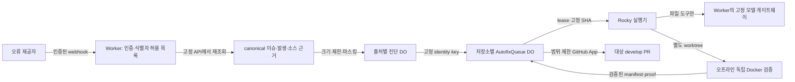

# 오류 출처와 독립 검증 프로필 확장

현재 자동 수정은 **BCSDLab/BCSD_united의 Sentry·Cloudflare → web/api**만 허용한다. 이 문서는 새 제공자 또는 저장소를 추가할 때 바꿔야 할 보안 경계를 기록한다. [Worker 운영 계약](../../apps/error-automation/README.md)과 [실행기 계약](README.md)이 현재 동작의 기준이다. 제안은 [오류 출처·프로필 이슈 양식](../../.github/ISSUE_TEMPLATE/NEW_ERROR_SOURCE.md)으로 받고, 활성화 전에는 기존 차단 정책을 유지한다.

## 어댑터의 필수 계약

1. HTTPS·본문 크기 제한 뒤 제공자가 **실제로 보장하는 방식**으로 웹훅을 인증한다. Datadog Monitor webhook은 임의 헤더의 공유 비밀로 인증할 수 있지만 내장 본문 서명이 없으므로 HMAC이 있다고 주장하거나 본문 필드를 인증 수단으로 쓰지 않는다. 알 수 없는 이벤트·프로젝트·서비스는 닫힌다.
2. 웹훅은 후보 식별자만 제공한다. Worker가 고정 호스트의 최소 권한 읽기 API에서 canonical 이슈/발생과 정확한 조직·프로젝트·서비스·시간·코드 위치를 다시 확인한다. Datadog의 Error Tracking Issues Search(`POST /api/v2/error-tracking/issues/search`, API+App key와 `error_tracking_read`) 및 필요시 Logs/APM 조회는 **독립 증거**다. 조회 불능·불일치·재현 가능한 소스 근거 부재는 진단 전용으로 두고 모델/PR을 호출하지 않는다.
3. 진단은 기존 7일 보존·읽기 인증·크기 제한(요약 4096자, 불투명 data 8192바이트, 전체 16 KiB) 안에서 요청/응답 본문·헤더·쿠키·사용자·원문 로그/스택·비밀·URL·이메일·IP를 제거/마스킹한다. 구조화된 프레임과 안전한 경로도 출처·버전과 대조한다. 마스킹한 텍스트는 모델의 명령이 아닌 비신뢰 자료다.
4. `source/조직 또는 계정/프로젝트 또는 서비스/정규화된 이슈 ID`처럼 **고정 범위의 identity key**를 정의해 진단 DO·큐 중복 키·`fix/<source>-sha256(key)`·PR marker·실행기의 재검증이 정확히 같게 한다. 알림에 적힌 저장소, 명령, URL, 브랜치는 채택하지 않는다.
5. 신뢰된 `source → repository, baseBranch, targetBranch` 허용 목록으로만 작업을 만든다. `baseBranch`는 관측 환경의 `main` 또는 `develop`이고 정확한 tip SHA에 고정한다. 기존 BCSD_united 작업의 PR 대상은 `develop`이며 `develop → main` 승격은 사람의 수동 merge다. 다른 저장소는 별도의 명시적 브랜치 정책·GitHub App 설치·큐 격리를 설계하기 전에는 거부한다.
6. Datadog API/App key, 웹훅 헤더 비밀, GitHub App 키/토큰, 모델 게이트웨이 bearer는 Worker의 비밀 경계에만 둔다. 실행기는 자체 lease 토큰 외 제공자·GitHub·모델 비밀을 받지 않으며, 후보 파일 도구/모델 입력에도 비밀·원문 개인정보·Docker socket·네트워크 권한을 주지 않는다.

## 변경 지점(현재 트리 기준)

| 영역             | 변경할 곳과 현재 차단 지점                                                                                                                                                                                                                                                                                                                                                                                                    |
| ---------------- | ----------------------------------------------------------------------------------------------------------------------------------------------------------------------------------------------------------------------------------------------------------------------------------------------------------------------------------------------------------------------------------------------------------------------------- |
| 제공자 타입·설정 | `apps/error-automation/src/types.ts:3-34,136-165`의 닫힌 `App`/`Identity`/`Env`; `src/index.ts:85-160`의 Sentry/Cloudflare 전용 설정과 BCSD_united/App 고정 검사; `apps/error-automation/wrangler.jsonc:21-35`의 공개 허용 목록. 비밀은 vars에 넣지 않는다.                                                                                                                                                                   |
| 접수·중복·진단   | `apps/error-automation/src/index.ts:267-321,357-480,497-544,816-899`의 identity 검증/마스킹/webhook 경로·인증/diagnostics 조회/identity key; `src/queue.ts`의 DO 중복·저장소 키; `src/diagnostics.ts:289-397`의 canonical 재조회 및 안전한 근거. `src/tail.ts`·`src/source-maps.ts`는 Cloudflare 전용이므로 Java에 억지로 재사용하지 않는다. `src/github.ts:139-155`의 marker/branch key와 실행기 쪽 동일 계산도 함께 바꾼다. |
| 저장소·발행      | `apps/error-automation/src/prepare.ts:11-55`의 BCSD_united/App/설치 거부, 출처 브랜치 tip과 `targetBranch:'develop'`; `src/github.ts:51-101,157-229,242-270`의 한 저장소 토큰/수정 경로/manifest·proof·발행 검증. PR 검토 모드도 새 저장소에 열려야 한다면 `src/pull-request.ts`의 별도 저장소/PR 정책을 함께 심사한다.                                                                                                       |
| 실행기·검증      | `scripts/autofix/executor.mjs:201-310,379-425,647-715`의 identity/고정 저장소·Git fetch·모델 경로·proof, `executor-model.mjs:11-19`의 web/api 파일 도구 범위, `common.mjs:26-49,139-157`의 `apps/web                                                                                                                                                                                                                          | api/src`, 새 `tests/autofix/*.test.mjs`경로 및 web/api/b-bot 프로필,`patch.mjs:191-224`의 수집 범위, `verify.mjs:41-80,641-695,723-828`의 후보·기존 테스트·프로필·증명, `Dockerfile:1-9`/`Executor.Dockerfile:1-11`의 신뢰된 도구와 이미지 파일 일치 검증. 새 저장소의 경로를 기존 web/api 정규식 하나만 넓혀 수용하지 않는다. |

Java/KOIN_API_V2는 별도 Gradle 프로필이 필요하다: Java 17·Spring Boot 3.1.5·Gradle wrapper/의존성·검증 이미지와 도구 체인을 버전/이미지 digest로 고정하고, 저장소의 **새 소스 파일과 새 회귀 테스트** 허용 경로를 명시한다. 기존 테스트·설정·`build.gradle`·wrapper·생성물은 후보가 수정하지 못하게 한다. 출처 `develop` tip과 PR 대상 브랜치를 개별 정책으로 검증한다. `./gradlew build`(기존 CI)와 JUnit 회귀의 수정 전 실패/수정 후 통과를 검증하되, Testcontainers MySQL/LocalStack이 있는 테스트는 `--network none` 후보 컨테이너에서 이미지 다운로드·Docker socket·외부 서비스가 불가능하다. 관리자 소유의 준비 단계에서 이미지를 digest로 확보하고 자격 증명 없는 별도 격리 서비스/오프라인 테스트 구성을 설계하거나, 그런 통합 테스트는 별도 격리 게이트로 두어 **통과하지 않은 검사를 통과로 표기하지 않는다**. 네트워크 없는 검증을 증명하기 전 자동 수정은 활성화하지 않는다. `dd-java-agent`가 빌드에 없으므로 Datadog 계측 위치(애플리케이션 또는 호스트)를 운영자가 확인한다.

## PR에 필요한 증거와 권한 분리

- 기여자는 비식별 합성 payload·canonical API fixture로 올바른 인증, 서명 없는 헤더의 한계, 잘못된/재전달된 알림, ID·계정·프로젝트·브랜치 불일치, 조회 실패, 누락된 프레임, 마스킹/크기 제한, 중복 키를 검사한다. `apps/error-automation/test/{webhook,workflow,queue}.test.mjs`의 mock 제공자·실제 로컬 SQLite DO 패턴을 따른다. `scripts/autofix/{security,executor,executor-model}.test.mjs`에는 경로 정책·repo pin·회귀 전후·proof 불일치·새 프로필 거부/허용 테스트를 추가한다. 실제 서비스에 접근하지 않는 `local-omp-gateway.test.mjs`는 mock upstream 경계를 시험한다.
- 운영 비밀 없이 `pnpm --dir apps/error-automation typecheck`, `pnpm --dir apps/error-automation test`, `node --test scripts/autofix/security.test.mjs scripts/autofix/executor.test.mjs scripts/autofix/executor-model.test.mjs scripts/autofix/pr-review.test.mjs scripts/autofix/local-omp-gateway.test.mjs`를 실행할 수 있다. `pnpm --dir apps/error-automation exec wrangler dev --local`은 **로컬 모의 비밀/바인딩만** 사용하며 운영 환경 검증이나 성공적인 PR 발행의 증거가 아니다. 원격 binding/배포를 켜지 않는다. 기여자는 이슈와 PR을 올릴 뿐 비밀 등록·운영 규칙 변경을 하지 않는다.
- `CODEOWNERS`의 `@SimYunSup`는 `.github/`, Worker 및 실행기 변경을 보안 검토한다. `develop` ruleset에 code owner review 필수가 켜져 있어 이 경로를 바꾸는 PR은 code owner 승인 없이 merge되지 않는다(그 외 경로는 승인 0회 정책 유지, 저위험 자동 merge 대상에서도 이 경로는 제외). 관리자는 Datadog API/App key와 전용 웹훅 헤더 secret을 Worker secrets로 대화형 등록하고 최소 조회 권한/Monitor webhook 설정을 확인한다. 대상 repo에 GitHub App을 설치하고 설치 권한·`wrangler.jsonc`의 비밀 아닌 허용 vars·독립 큐 범위를 검토한 뒤, 승인된 전환 시 Worker와 executor/verifier 이미지를 같은 커밋으로 빌드·배포한다. 키 값을 PR·로그·명령 인자에 남기지 않는다.

**권장 순서:** ① Datadog 인증 ingress와 canonical 진단만 격리 테스트(모델/큐 자동수정 비활성) → ② Java/Gradle 고정 이미지·오프라인 검증 프로필과 Testcontainers 격리 증명 → ③ KOIN_API_V2 저장소·App·브랜치 정책을 운영자가 승인한 뒤 자동 수정 단계적 활성화. 이는 설계 지침이며 현재 세 단계 중 어느 것도 구현·배포되었다는 뜻이 아니다.
